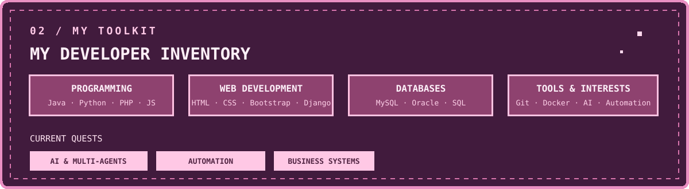

 

 

 

## ✨ Selected projects

- **JavaFX Agenda** — desktop event-management app using Java, JavaFX, JDBC, and Oracle.
- **Multi-Agent Production Dashboard** — Streamlit dashboard with Planner → Executor → Critic agents, API fault injection, fallback, and KPI reporting.
- **Uber-Cueillette** — PHP/MySQL web platform concept connecting Tunisian farmers with seasonal agricultural workers.

## 🌷 Let's connect

<i>Learning, creating, and growing — one commit at a time. ♡</i>

